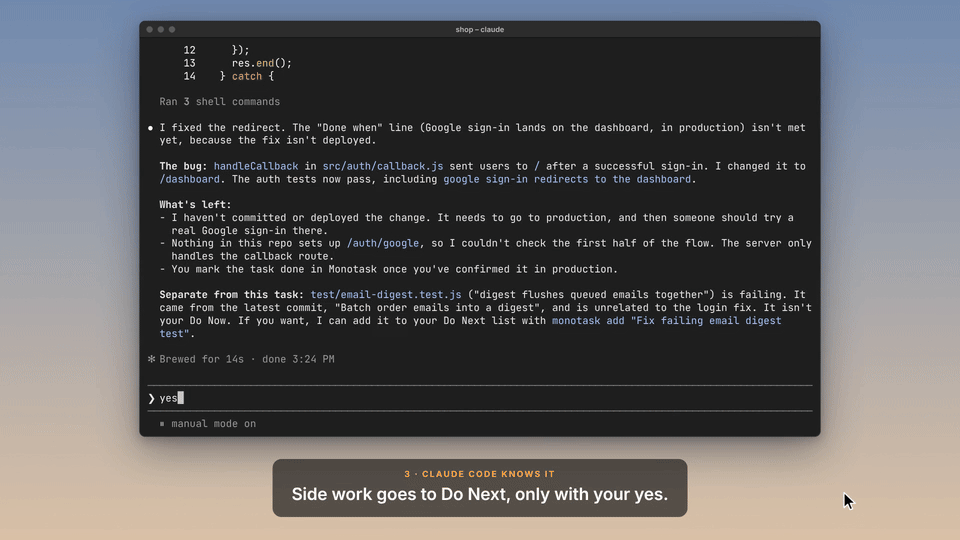

# Monotask

**One task at a time, in your MacBook's notch. Your coding agents know it too.**

<p align="center"></p>

AI agents made starting things free. Finishing is still on you.

Monotask holds exactly one task, your **Do Now**, with a **finish line**: one sentence that says what done means. Everything else waits in **Do Next**. A task only counts as done when you hold the button, and you only hold it when the task is done end to end.

Then it tells your coding agent. Every Claude Code and Codex session knows your one task and its finish line, keeps its changes to that, tells you plainly whether the finish line is met, and parks side quests in Do Next only after you say yes.

> Notch apps for agents show you what your agent is doing. Monotask tells your agent what you're doing.

Free and open source (MIT). No accounts, no cloud, no telemetry.

## How it works

| | |
| --- | --- |
| **Capture** | ⌥Space from any app. Type it, press Return, and you're back where you were. It waits in Do Next. |
| **Start one task** | Write what done looks like. That's the finish line, and it's shown back to you while you finish. |
| **It stays in your notch** | A live dot and a timer sit either side of the camera. Rest the pointer on the notch to see the task. |
| **Only you finish it** | Hold to mark done for about a second. Letting go early cancels. |
| **Can't finish?** | Split it (the first piece becomes Do Now), park it as blocked, or drop it. Each needs a reason, and none of them count as done. |

Do Next shows the top three; the rest fold into Later. Hover a row to move it up or start it, right-click to reorder, rename or delete. "N done this week" opens the log of everything finished or dropped.

## With Claude Code and Codex

Install the plugin once and every session knows your Do Now and its finish line. Nothing to paste, no command to remember.

**Claude Code**

```
claude plugin marketplace add Avi130805/monotask
claude plugin install monotask@monotask
```

**Codex**

```
codex plugin marketplace add Avi130805/monotask
codex plugin add monotask@monotask
```

Then start `codex` in a terminal, run `/hooks`, and approve the eight Monotask hooks once.

What changes:

- **Your task travels with you.** Open a session in any folder and the agent already knows the one thing you're working on and what done means.
- **It stays in scope.** Ask for something unrelated and it says once that it isn't your Do Now, then helps anyway. It never blocks you.
- **It tells you what's left.** Done means your finish line is met end to end, and the agent says plainly whether it is.
- **Side quests wait.** A flaky test it trips over goes to your Do Next, and only after you say yes.
- **Only you finish.** Agents can't start, change or finish your Do Now. Information flows one way, into the agent; the notch only ever shows "Added to Do Next".

The plugin sends your task title and finish line to your agent, and through it to the agent's model provider. Nothing else leaves your Mac, and the plugin makes no network calls of its own. Details, including exactly what the agent sees: [plugins/monotask](plugins/monotask/README.md).

## Lid-closed mode (experimental)

Off by default. **Lid-Closed Mode…** in the ••• menu opens its window. Switched on, it lets Claude Code and Codex keep working after you close your MacBook's lid, and only while one of them is working. When they finish, your Mac sleeps as usual. Nothing about it appears in the notch.

It knows an agent is working from the plugin's hooks: a prompt or a running tool marks the session busy; the end of its turn, a permission prompt, an interrupt or a failed turn marks it idle. A tool counts as running for 30 minutes, or up to an hour while its processes are using the CPU. In Codex, approve all eight hooks in `/hooks`.

**What it installs.** Only an administrator can keep a Mac awake with its lid closed (`pmset -a disablesleep 1`), so the first time you switch it on, Monotask explains why and asks for your password or Touch ID to install a small helper:

- `/Library/PrivilegedHelperTools/io.github.avi130805.Monotask.lid`, a short POSIX shell script (root:wheel, 755)
- `/Library/LaunchDaemons/io.github.avi130805.Monotask.lid.plist`, which runs it (root:wheel, 644)

Both are plain text in [Sources/Monotask/Core/LidHelper.swift](Sources/Monotask/Core/LidHelper.swift), so you can read them first. The helper writes a one-line status to `/Library/Application Support/Monotask/`.

**How it stays safe.**

- The helper turns sleep off only while Monotask keeps renewing a one-minute lease file. If Monotask quits, crashes or hangs, the lease runs out and the Mac sleeps within about a minute.
- It turns sleep back on whenever it starts (so after a restart), when it's stopped, and when it's removed. It never changes a sleep setting it didn't make, and it stops after 8 hours awake in a row whatever Monotask says, until there has been no lease for 10 minutes while the Mac is awake.
- Monotask lets the Mac sleep when the agents finish (2 minutes later, by default), when it gets hot (critical heat always, whatever the setting), when the battery is at or below 25% (you choose, never under 10%) or its level can't be read, when it's on battery and you haven't allowed that, in Low Power Mode, after 2 hours with the lid closed (30 minutes to 6 hours), or when the internet has been gone for 15 minutes.
- Once one of those stops it, it stays stopped until you open the lid, even if the agents stop and start again or the Mac wakes for a moment in a bag, so it never flip-flops. A lid that can't be read counts as closed.
- While an agent works your Mac doesn't sleep at all, lid open or closed: the setting has to be on before the lid closes.

A closed MacBook can't cool itself well, especially in a bag. Give it some air.

**If the internet drops** (off by default, *Find a working network if the internet drops*): with the lid closed, Monotask waits for macOS to reconnect, turns Wi-Fi off and on once, then tries the fallback networks you listed, in your order. Monotask keeps no Wi-Fi passwords: it joins with the one macOS saved, so join each fallback network once from the Wi-Fi menu first. A network macOS has no password for is skipped, and the window says so. It makes at most 3 attempts in 10 minutes and 6 in an hour, waits longer before retrying a network each time it fails, and gives up after 15 minutes offline, which lets the Mac sleep. To fall back to your iPhone, turn on Personal Hotspot's *Allow Others to Join*, and set *Ask to join hotspots* to *Automatic* in your Mac's Wi-Fi settings.

**Removing it.** *Remove Helper…* in the window, or by hand:

```
sudo launchctl bootout system/io.github.avi130805.Monotask.lid
sudo rm /Library/LaunchDaemons/io.github.avi130805.Monotask.lid.plist
sudo rm /Library/PrivilegedHelperTools/io.github.avi130805.Monotask.lid
sudo rm -rf "/Library/Application Support/Monotask"
sudo pmset -a disablesleep 0
```

`pmset -g | grep SleepDisabled` shows `0` once sleep is back to normal.

## What Monotask doesn't do

No projects, priorities, due dates, estimates, tags, sprints, accounts or sync. If a feature would ask you to plan, sort or review your list, it isn't here. That's the point.

## Install

1. Download `Monotask.zip` from [the latest release](https://github.com/Avi130805/monotask/releases/latest), unzip it, and drag **Monotask** into Applications.
2. Open it. The first time, macOS says it can't check the app for malicious software, because it isn't notarized. Open **System Settings → Privacy & Security**, scroll down, click **Open Anyway** next to Monotask, and confirm.
3. Or build it yourself from source (below); it takes a minute with only the Command Line Tools.

Needs macOS 15 or later on Apple silicon. It's made for MacBooks with a notch; on a display without one it hangs a small notch-shaped pill from the top of the screen.

Used **Next**, the earlier name? On first launch Monotask copies your list, history and settings over. Next's own files are left as they were.

<details>
<summary><b>Insights</b></summary>

Open it from the ••• menu (**Insights…**) or the **Insights** button on the log page. While it's open, Monotask shows in the Dock and ⌘-Tab; closing it puts Monotask back in the notch only.

For the last 7 days, 30 days or all time:

- **Finished**, compared with the period before, and **finish rate** (done out of done plus dropped).
- **Time to finish**: the median time from first starting a task to marking it done, and how those times spread out.
- **Streak**: days in a row with at least one finish, and your best.
- **When you finish**, by hour of day.
- **In and out**: what you captured against what you finished each week, and whether your list is growing or shrinking.
- **What blocked you** and **why things were dropped**, in your own words.
- **History** of every task that ended, with how long it took.
</details>

## Where your data lives

Everything is in `~/Library/Application Support/Monotask/`:

- `state.json` holds Do Now, Do Next and the log. It's rewritten whenever something changes.
- `events.jsonl` is the history Insights are built from: one line per capture, start, split, block, drop, delete or finish. Lines are only ever added.
- `backups/` keeps the first copy of both files from each of the last 14 days.
- `agent-context.md` is what coding agents read: your Do Now and its finish line. It exists only while something is in Do Now, and only while Monotask is running.
- `inbox/` is where agents drop items for Do Next. Sandboxed agents use `monotask-inbox/` in your per-user temporary folder (`getconf DARWIN_USER_TEMP_DIR`) instead. Monotask imports both and empties them.

## Building

Needs only Apple's Command Line Tools (Swift 6). No Xcode.

Command Line Tools 27 ship a macOS 27 SDK where SwiftUI's `@State` needs a macro plugin that only Xcode includes. `scripts/build.sh` notices and builds against an older installed SDK. For a plain `swift build`, point it at one yourself: `SDKROOT=/Library/Developer/CommandLineTools/SDKs/MacOSX26.5.sdk swift build`.

```bash
./scripts/build.sh            # builds build/Monotask.app
./scripts/build.sh --install  # also copies it to /Applications
./scripts/release.sh          # builds and zips a release into dist/
```

Checks and previews:

```bash
.build/debug/Monotask --selftest          # the task rules, history, Insights maths, agent bridge and migration
.build/debug/Monotask --snapshot shots/   # renders every notch state with demo data
sh plugins/monotask/test/run.sh           # the agent plugin
```

All of them use throwaway files, so they never touch your real list.

## Credits

The notch outline comes from [DynamicNotchKit](https://github.com/MrKai77/DynamicNotchKit) by Kai Azim (MIT); see [THIRD_PARTY_NOTICES.md](THIRD_PARTY_NOTICES.md). [boring.notch](https://github.com/TheBoredTeam/boring.notch) and [NotchDrop](https://github.com/Lakr233/NotchDrop) showed what a notch app can feel like.

## License

[MIT](LICENSE)
