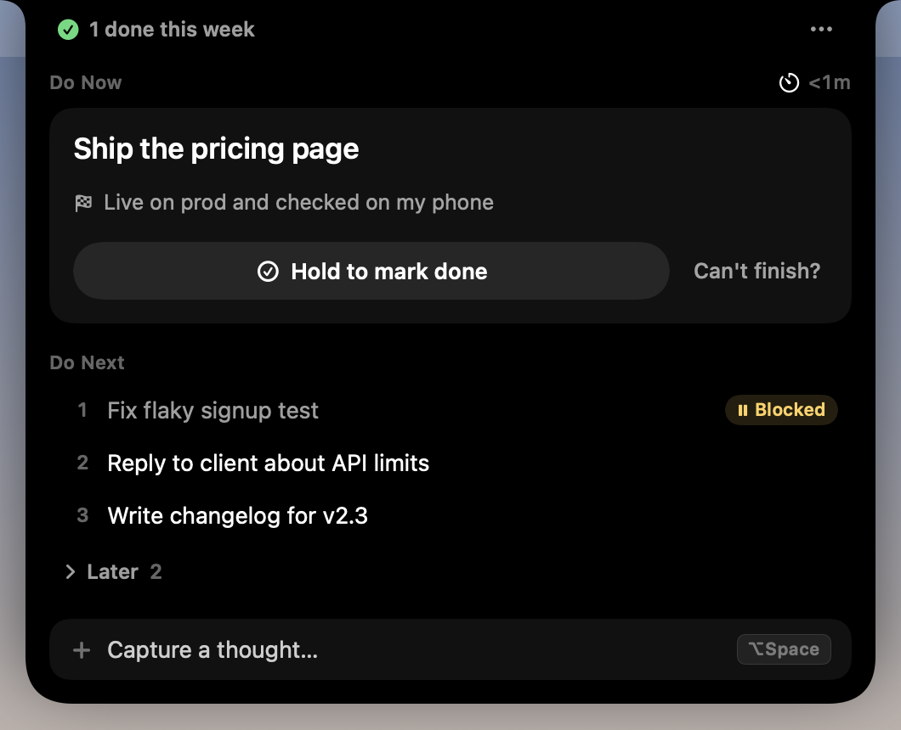
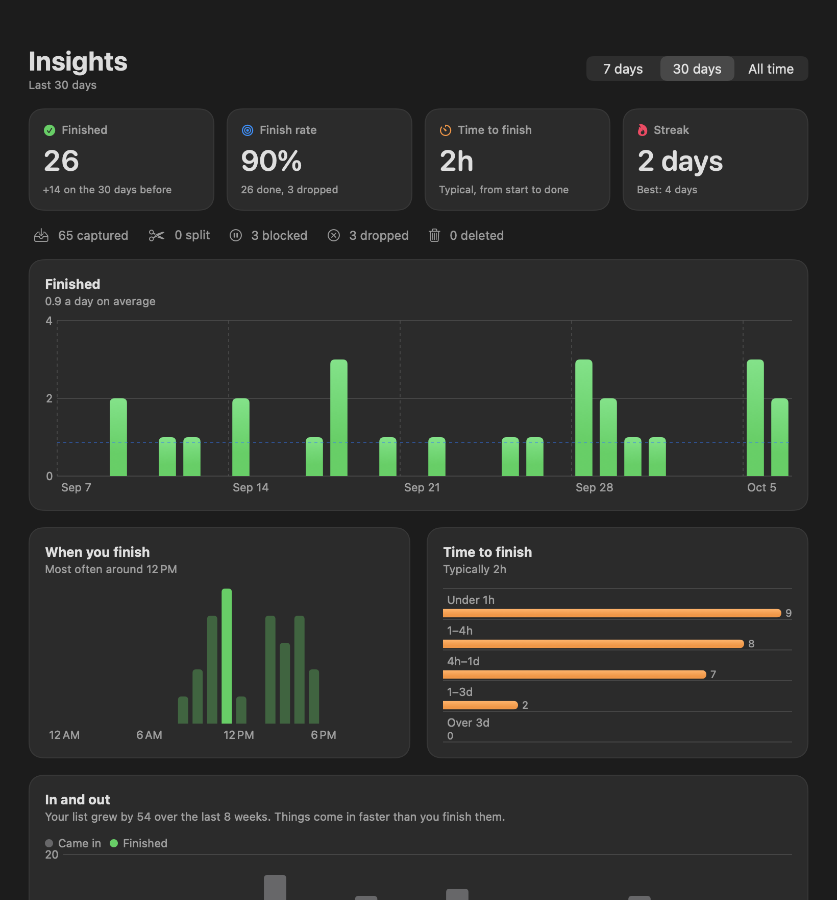
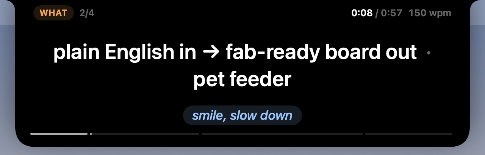

# Next

A notch app for finishing one thing at a time. **Do Now** holds exactly one task, and it only counts as done when you hold the button to say it's done end to end. Everything else waits in **Do Next**.




## Using it

- **While something is in Do Now**, an amber dot and a timer sit either side of the camera. Rest the pointer on the notch to see the task and its finish line below it. Everything stays centred on the camera.
- **Click the notch** to open it. Passing over it makes it swell slightly; turn on "Open on hover" in the ••• menu if you'd rather not click.
- **⌥Space** from anywhere opens a capture field under the notch. Type, press Return, and you're back in your app. Esc cancels.
- **Start** a task by writing what done looks like. That line is shown back to you while you hold to finish.
- **Hold to mark done** for about a second to finish. Letting go early cancels.
- **Can't finish?** lets you split it (the first piece becomes Do Now, the whole task goes back to the top of Do Next), park it as blocked, or drop it. Each needs a reason, and none of them count as done.
- **Do Next** shows the top 3; the rest fold into Later. Hover a row for move-up and start, right-click to reorder, rename or delete, or double-click to rename.
- **"N done this week"** in the top left opens the log of everything finished or dropped.

## Insights

Open it from the ••• menu (**Insights…**) or the **Insights** button on the log page. While it's open, Next shows in the Dock and ⌘-Tab; closing it puts Next back in the notch only.



For the last 7 days, 30 days or all time:

- **Finished**, compared with the period before, and **finish rate** (done out of done plus dropped).
- **Time to finish**: the median time from first starting a task to marking it done, and how those times spread out.
- **Streak**: days in a row with at least one finish, and your best.
- **When you finish**, by hour of day.
- **In and out**: what you captured against what you finished each week, and whether your list is growing or shrinking.
- **What blocked you** and **why things were dropped**, in your own words.
- **History** of every task that ended, with how long it took.

## Prompter

For recording a short talking-to-camera video, or rehearsing one. The script sits right under the camera, so your eyes stay close to the lens.



- **⌥P** from any app (or **Start Prompter** in the ••• menu) puts it under the notch with a 3-2-1 countdown. **⌥P** again or **Esc** leaves. If ⌥P is taken, it falls back to ⌃⌥P; the ••• menu shows which.
- **Cue mode** (the default) shows one section at a time: its label beside the camera and a few keywords to talk around. It moves on when the section's time is up, or when you press →. The last cue stays up until you press → or leave.
- **Word mode** shows the script one word at a time, with the next word faint beside it, for rehearsing. **M** switches between the two and keeps your place.
- **Space** pauses and resumes, **← →** go back or forward a word (a section in Cue mode), **↑ ↓** change the speed by 10 words a minute (150 to start), **R** starts again from the top.
- The time you've spent speaking is shown against the script's budget and turns amber once you're over. A thin line under the text shows how far through the script you are, section by section.
- Next remembers the mode, the speed and where you were, and picks up there next time (the countdown says where from). Editing the script starts it from the top.
- It takes the keyboard while it's up. If you click another app (to start recording, say), click the prompter once to give it the keys back.
- Prompting is never a task: it doesn't touch Do Now or Do Next, writes no events and doesn't show in Insights.

The script is a plain text file, `~/Library/Application Support/Next/prompter.txt`. It's created with a sample script the first time you open the prompter. Edit it from **Prompter…** in the ••• menu (paste, edit, Save, or Save and start), which also tells you how long it runs at your speed and how much to cut if it's over its budget. You can also edit the file in any text editor.

| Markup | Means |
| --- | --- |
| `# WHO (8s)` | A section, shown as a label, with an optional time budget. The sections' budgets add up to the script's; without them it's a minute. |
| `@cue: plain English · pet feeder` | The keywords Cue mode shows for this section, split on `·` (or commas if there's no `·`). Without one, Cue mode shows the section's emphasised words. |
| `>> smile` | A note to yourself, shown in its own colour for a few seconds and never read as a word. |
| `*plain English*` | Emphasis: bold and amber. |
| `/` | A short pause, about 0.35 s. |
| `//` | A long pause, about 0.8 s. |
| `...` | A beat, about 0.5 s, shown as "…". |
| `[slow] … [/slow]` | 0.75× speed for the span. `[fast] … [/fast]` is 1.25×. |
| `{look}` | A full-width "look at the lens" flash for about 0.6 s. |

Punctuation adds natural pauses on its own: about 0.2 s after a comma, 0.45 s after a full stop and 0.3 s at an em dash. A pause mark straight after punctuation replaces its pause rather than adding to it. Each word gets time for its length: a five-letter word gets one word's worth at the current speed, and shorter or longer words a little less or more.

## Where your data lives

Everything is in `~/Library/Application Support/Next/`:

- `state.json` holds Do Now, Do Next and the log. It's rewritten whenever something changes.
- `events.jsonl` is the event history the Insights are built from. It has one line per capture, start, split, block, drop, delete or finish, and lines are only ever added. If you upgrade from a version without it, it's rebuilt once from your existing log.
- `backups/` keeps the first copy of both files from each of the last 14 days.
- `prompter.txt` is the prompter's script. Next only writes it when you save from **Prompter…**, or to put the sample there if it's missing.

## Building

Needs only Apple's Command Line Tools (Swift 6). No Xcode.

```bash
./scripts/build.sh            # builds build/Next.app
./scripts/build.sh --run      # builds and launches it
./scripts/build.sh --install  # copies it to /Applications
```

Checks and previews:

```bash
.build/debug/Next --selftest          # the task rules, the event history, the Insights maths and the prompter's markup and timing
.build/debug/Next --snapshot shots/   # renders every notch state, the prompter, the Insights window and the script editor with demo data
```

Both use throwaway files, so they never touch your real list.

## Credits

Notch shape from [DynamicNotchKit](https://github.com/MrKai77/DynamicNotchKit) (MIT, Kai Azim). Spring tuning, window setup and hover handling follow [boring.notch](https://github.com/TheBoredTeam/boring.notch) and [NotchDrop](https://github.com/Lakr233/NotchDrop).
